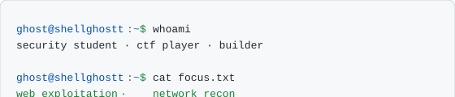
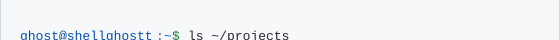
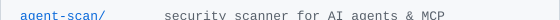
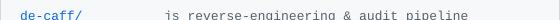
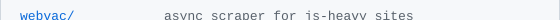
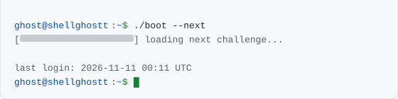

<!-- oss-profile-v1 -->
## Hi, I'm Aditya (Shellghostt)

Freelance Python & TypeScript developer building open-source web scraping and security tooling.

### What I maintain
- **[WebVac](https://github.com/Shellghostt/WebVac)** - asyncio scraping & crawling for JS-heavy targets (Patchright, proxy rotation, sessions)
- **[De-Caffeinator](https://github.com/Shellghostt/De-Caffeinator)** - JavaScript reverse engineering & asset analysis for security auditing
- **[NYRA](https://github.com/Shellghostt/NYRA-Natural-Yoga-Recognition-Assistant)** - real-time yoga pose recognition with Python

### What I contribute to
Scraping, browser-automation and security projects in Python/TypeScript. Recent merged work: prompt-injection defence in BaitWatch, fresh-clone launch fix in builderbot-minecraft-agent.

### Stack
Python - TypeScript - asyncio - Playwright/Patchright - Node.js

---

<picture>
  <source media="(prefers-color-scheme: dark)" srcset="https://raw.githubusercontent.com/Shellghostt/Shellghostt/main/assets/top_dark.svg">
  
</picture>

<a href="https://github.com/Shellghostt?tab=repositories"><picture>
  <source media="(prefers-color-scheme: dark)" srcset="https://raw.githubusercontent.com/Shellghostt/Shellghostt/main/assets/ph_dark.svg">
  
</picture></a>

<a href="https://github.com/Shellghostt/agent-scan"><picture>
  <source media="(prefers-color-scheme: dark)" srcset="https://raw.githubusercontent.com/Shellghostt/Shellghostt/main/assets/p1_dark.svg">
  
</picture></a>

<a href="https://github.com/Shellghostt/De-Caffeinator"><picture>
  <source media="(prefers-color-scheme: dark)" srcset="https://raw.githubusercontent.com/Shellghostt/Shellghostt/main/assets/p2_dark.svg">
  
</picture></a>

<a href="https://github.com/Shellghostt/WebVac"><picture>
  <source media="(prefers-color-scheme: dark)" srcset="https://raw.githubusercontent.com/Shellghostt/Shellghostt/main/assets/p3_dark.svg">
  
</picture></a>

<picture>
  <source media="(prefers-color-scheme: dark)" srcset="https://raw.githubusercontent.com/Shellghostt/Shellghostt/main/assets/bot_dark.svg">
  
</picture>

<picture>
  <source media="(prefers-color-scheme: dark)" srcset="https://raw.githubusercontent.com/Shellghostt/Shellghostt/main/assets/github-contribution-grid-snake-dark.svg">
  
</picture>

