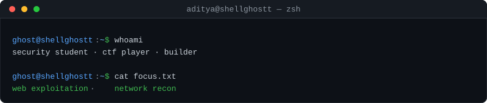
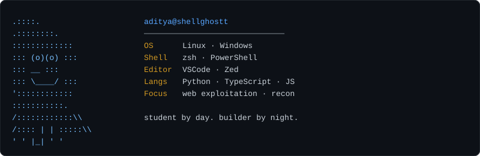

<pre></pre>

---

| Metrics                                                            | Stats                                                                                                                                                             |
| :----------------------------------------------------------------- | :---------------------------------------------------------------------------------------------------------------------------------------------------------------- |
|  |   |

---

  

---

  

