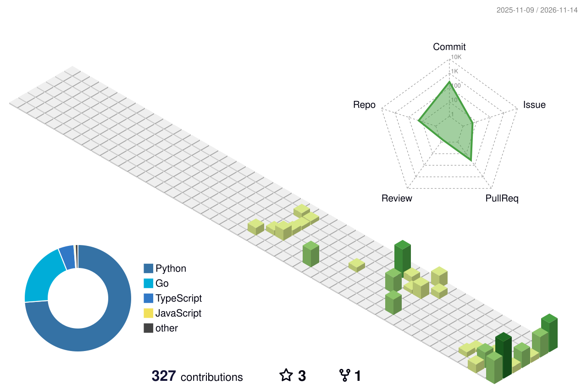
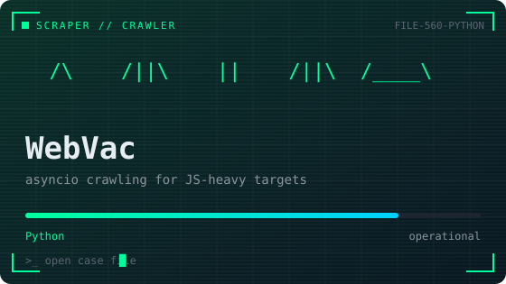
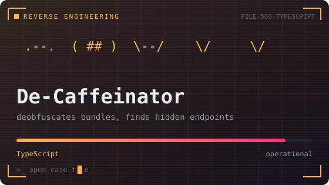
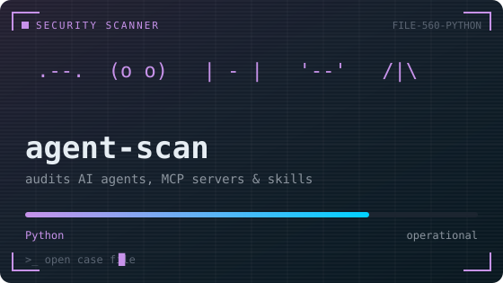

<!-- README_V2 — "MISSION CONTROL" concept. To use: copy over README.md. -->

  

  

<h2>🗺️ sector map</h2>

  

<h2>🗂️ case files</h2>

  
  
  

<h2>🏆 commendations</h2>

  

<h2>📈 activity feed</h2>

  

